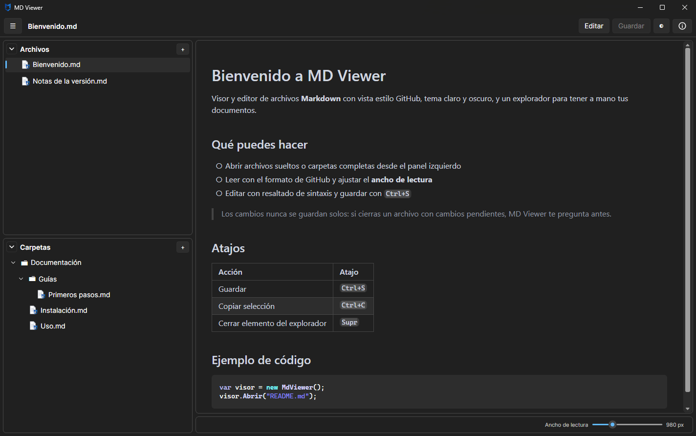
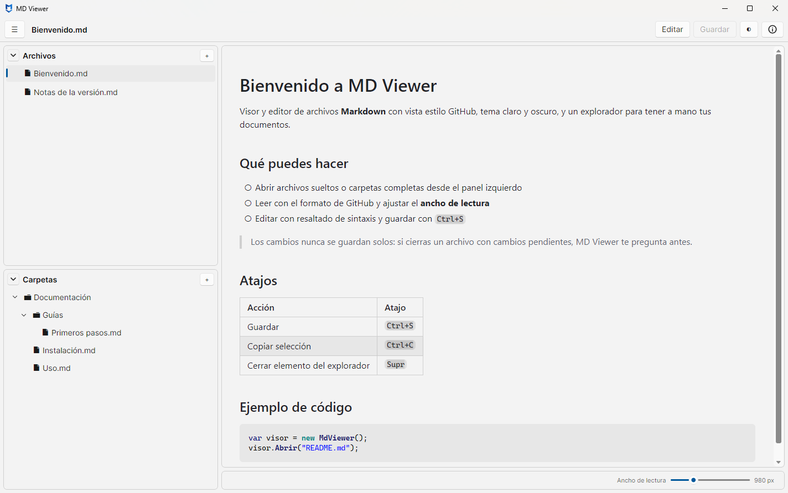

<p align="center">
  
</p>

<h1 align="center">MD Viewer</h1>

<p align="center">
  Visor y editor de archivos <b>Markdown</b> para escritorio, con vista estilo GitHub, tema claro y oscuro,<br>
  y un explorador para tener a mano tus documentos.
</p>

<p align="center">
  
  
  
  <a href="LICENSE"></a>
</p>

<p align="center">
  
  
</p>

---

## Contenido

- [Características](#características)
- [Atajos](#atajos)
- [Instalación](#instalación)
- [Desarrollo](#desarrollo)
- [Generar instaladores](#generar-instaladores)
- [Estructura del proyecto](#estructura-del-proyecto)
- [Tecnologías](#tecnologías)
- [Licencia](#licencia)
- [Autor](#autor)

## Características

### Visor
- Vista con el **formato de GitHub** (títulos, tablas, citas, código con resaltado de sintaxis), en tema claro y oscuro.
- **Ancho de lectura** ajustable desde la barra inferior (480 – 2400 px), con el texto siempre centrado.
- **Selección de texto** como en un editor: arrastrar, doble clic (palabra) y triple clic (párrafo); `Ctrl+C` copia
  también el código en línea y los enlaces.
- Botón de **copiar** en cada bloque de código.

### Editor
- Resaltado de sintaxis Markdown y números de línea, a todo el ancho de la ventana.
- **Sin guardado automático**: se guarda solo con **Guardar** o `Ctrl+S`. Al cambiar de archivo, cerrarlo o salir con
  cambios pendientes, pregunta: *Guardar / No guardar / Cancelar*.

### Explorador
- Dos paneles: **Archivos** (archivos `.md` sueltos) y **Carpetas** (muestran solo subcarpetas y `.md`).
- Agrega con **+**; cada elemento muestra una **✕** al pasar el mouse para cerrarlo (solo lo quita de la lista, no
  borra nada del disco).
- Un clic en cualquier parte de una carpeta la despliega o la pliega.
- Alto de los paneles ajustable con el separador; cada panel se puede **minimizar** con **▾**.
- Ancho ajustable arrastrando su borde derecho; en ventanas angostas se oculta y se abre con **☰**.
- La lista se recuerda entre sesiones.

### Integración con el sistema
- Abrir un `.md` desde el explorador de archivos del sistema lo agrega a **Archivos** y lo muestra.
- **Una sola instancia**: si la app ya está abierta (aunque esté minimizada), el archivo se envía a esa ventana,
  que se restaura y pasa al frente.
- Icono propio para los archivos `.md` (hoja con el logo de la app) en Windows, macOS y Linux.
- Arranque rápido: la ventana aparece primero y el documento se carga después; los instaladores usan código
  precompilado (ReadyToRun).

### Ventana
- Abre maximizada, con el tema del sistema; **◐** cambia entre claro y oscuro.
- **ⓘ** abre *Acerca de*: versión, fecha de publicación, tecnología y autor.

## Atajos

| Acción | Atajo |
|---|---|
| Guardar | `Ctrl+S` |
| Copiar la selección del visor | `Ctrl+C` |
| Seleccionar palabra / párrafo | Doble clic / triple clic |
| Cerrar el elemento seleccionado del explorador | `Supr` |
| Cancelar un diálogo / cerrar *Acerca de* | `Esc` |

## Instalación

Descarga el instalador de tu sistema desde
[**Releases**](https://github.com/CAEBB-DEV/md-viewer/releases) (o [genéralo](#generar-instaladores)) y ejecútalo:

| Sistema | Instalador | Cómo instalar |
|---|---|---|
| Windows 10/11 (x64) | `MdViewer-Setup-<versión>.exe` | Ejecutarlo y seguir el asistente. |
| macOS (Apple Silicon) | `MdViewer-<versión>-osx-arm64.dmg` | Abrirlo y arrastrar **MD Viewer** a **Aplicaciones**. |
| Debian / Ubuntu (x64) | `mdviewer_<versión>_amd64.deb` | `sudo apt install ./mdviewer_<versión>_amd64.deb` |

Para **actualizar**, instala la versión nueva encima de la anterior: el instalador de Windows la detecta, cierra la
app si está abierta y la reemplaza conservando accesos directos; en macOS elige **Reemplazar**; en Linux `apt`
reemplaza el paquete.

> **App predeterminada para `.md`**: para que los `.md` se abran con doble clic y muestren su icono, elige MD Viewer
> como app predeterminada:
> - **Windows**: clic derecho en un `.md` → *Abrir con* → *Elegir otra aplicación* → **MD Viewer** → *Siempre*.
> - **macOS**: Finder → *Obtener información* → *Abrir con* → **MD Viewer** → *Cambiar todo*.
> - **Linux**: el icono se aplica a todos los `.md`; elige la app en *Abrir con* de tu gestor de archivos.

La lista del explorador se guarda en `explorador.txt` dentro de la carpeta de datos de la app:
`%APPDATA%\MdViewer` en Windows y `~/.config/MdViewer` en macOS y Linux.

## Desarrollo

**Requisitos:** [.NET 10 SDK](https://dotnet.microsoft.com/download). Recomendado: VS Code con las extensiones
**C# Dev Kit** y **Avalonia for VS Code** (el proyecto las sugiere al abrirlo).

```bash
git clone https://github.com/CAEBB-DEV/md-viewer.git
cd md-viewer
dotnet run --project src/MdViewer
```

En VS Code: **F5** compila y depura; la tarea **watch** recompila al guardar.

## Generar instaladores

### Publicar una versión (los 3 instaladores)

En VS Code: **Terminal → Ejecutar tarea… → Publicar versión (3 instaladores)**. La tarea
([`tools/publicar-version.ps1`](tools/publicar-version.ps1) / [`.sh`](tools/publicar-version.sh)):

1. sube la versión (1.1 → 1.2), hace commit y crea la etiqueta `v1.2`;
2. la sube a GitHub, donde [GitHub Actions](.github/workflows/release.yml) genera en paralelo los instaladores de
   **Windows, macOS y Linux con la misma versión** (cada uno en su propio sistema);
3. los publica como **Release** descargable en
   [Releases](https://github.com/CAEBB-DEV/md-viewer/releases). Tarda unos minutos; el avance se ve en
   [Actions](https://github.com/CAEBB-DEV/md-viewer/actions).

Requiere no tener cambios sin commit.

### Un instalador en tu equipo

Cada tarea **Instalador: …** sube la versión, publica la app para su plataforma y la empaqueta en tu equipo; el
resultado queda en `dist/`.

| Tarea | Resultado | Dónde ejecutarla | Requisito |
|---|---|---|---|
| **Instalador: Windows** | `MdViewer-Setup-<versión>.exe` | Windows | [Inno Setup 6](https://jrsoftware.org/isinfo.php) (`winget install JRSoftware.InnoSetup`) |
| **Instalador: macOS** | `MdViewer-<versión>-osx-arm64.dmg` | Mac | Xcode Command Line Tools |
| **Instalador: Linux** | `mdviewer_<versión>_amd64.deb` | Linux, o Windows con WSL | `dpkg-deb` |

**Versión.** Se toma de `<Version>` en [MdViewer.csproj](src/MdViewer/MdViewer.csproj) con formato `mayor.menor`.
Cada tarea de instalador sube el segundo número (1.0 → 1.1 → 1.2…) con
[`tools/subir-version.ps1`](tools/subir-version.ps1) o [`tools/subir-version.sh`](tools/subir-version.sh); para un
cambio mayor (2.0) edítala a mano. Si generas instaladores de varias plataformas para una misma entrega, cada uno
sube la versión por separado. La fecha de publicación de *Acerca de* es la de la compilación.

<details>
<summary><b>Detalles por plataforma</b></summary>

- **Windows** ([packaging/windows](packaging/windows)) — Inno Setup instala en *Program Files* (para todos los
  usuarios), con accesos directos, desinstalador y el tipo **Documento Markdown** (icono `mdfile.ico`) en *Abrir con*.
  El `AppId` del `.iss` enlaza las versiones entre sí: no lo cambies.
- **macOS** ([packaging/macos](packaging/macos)) — Arma `MD Viewer.app` (iconos `app.icns` y `mdfile.icns`, tipo de
  documento Markdown en `Info.plist`) y la firma *ad-hoc*. Para distribuirla a otros equipos hay que firmarla con un
  certificado *Developer ID* y notarizarla. Para Mac Intel, cambia `osx-arm64` por `osx-x64` en
  [`build.sh`](packaging/macos/build.sh) y en la tarea `publicar: osx-arm64`.
- **Linux** ([packaging/linux](packaging/linux)) — El `.deb` instala la app en `/opt/mdviewer`, el comando
  `mdviewer`, el lanzador del menú, el icono y el tipo `text/markdown` con su icono de documento.

</details>

## Estructura del proyecto

```text
md-viewer/
├── src/MdViewer/
│   ├── App.axaml(.cs)          # Arranque y archivos recibidos del sistema
│   ├── Program.cs
│   ├── SingleInstance.cs       # Una sola ventana por usuario
│   ├── ViewModels/             # MainViewModel (archivo abierto, explorador) y FsNode (árbol)
│   ├── Views/                  # Ventana principal y "Acerca de"
│   ├── Styles/                 # GithubMarkdown.axaml: estilo GitHub del visor
│   └── Assets/                 # Icono de la app y logo del autor
├── packaging/                  # Instaladores: windows/ (Inno Setup), macos/ (.dmg), linux/ (.deb)
├── tools/                      # Subida de versión y publicación
├── .github/workflows/          # release.yml: genera y publica los 3 instaladores
├── docs/                       # Capturas de este README
└── .vscode/                    # Depuración, extensiones y tareas (build, watch, instaladores)
```

## Tecnologías

- [.NET 10](https://dotnet.microsoft.com/) y [Avalonia UI 12](https://avaloniaui.net/) (tema Fluent 2)
- [Markdown.Avalonia](https://github.com/whistyun/Markdown.Avalonia) — renderizado del Markdown
- [AvaloniaEdit](https://github.com/AvaloniaUI/AvaloniaEdit) + [TextMateSharp](https://github.com/danipen/TextMateSharp) — editor con resaltado de sintaxis
- [CommunityToolkit.Mvvm](https://github.com/CommunityToolkit/dotnet) — patrón MVVM
- [Inno Setup](https://jrsoftware.org/isinfo.php) — instalador de Windows

## Licencia

Distribuido bajo la licencia **MIT**: puedes usar, copiar, modificar y distribuir este software, también con fines
comerciales, siempre que conserves el aviso de copyright y el texto de la licencia. Se ofrece "tal cual", sin
garantía. Consulta el archivo [LICENSE](LICENSE) para el texto completo.

## Autor

<p>
  
  Desarrollado por <b>CAEBB</b>.
</p>
<br clear="left">
